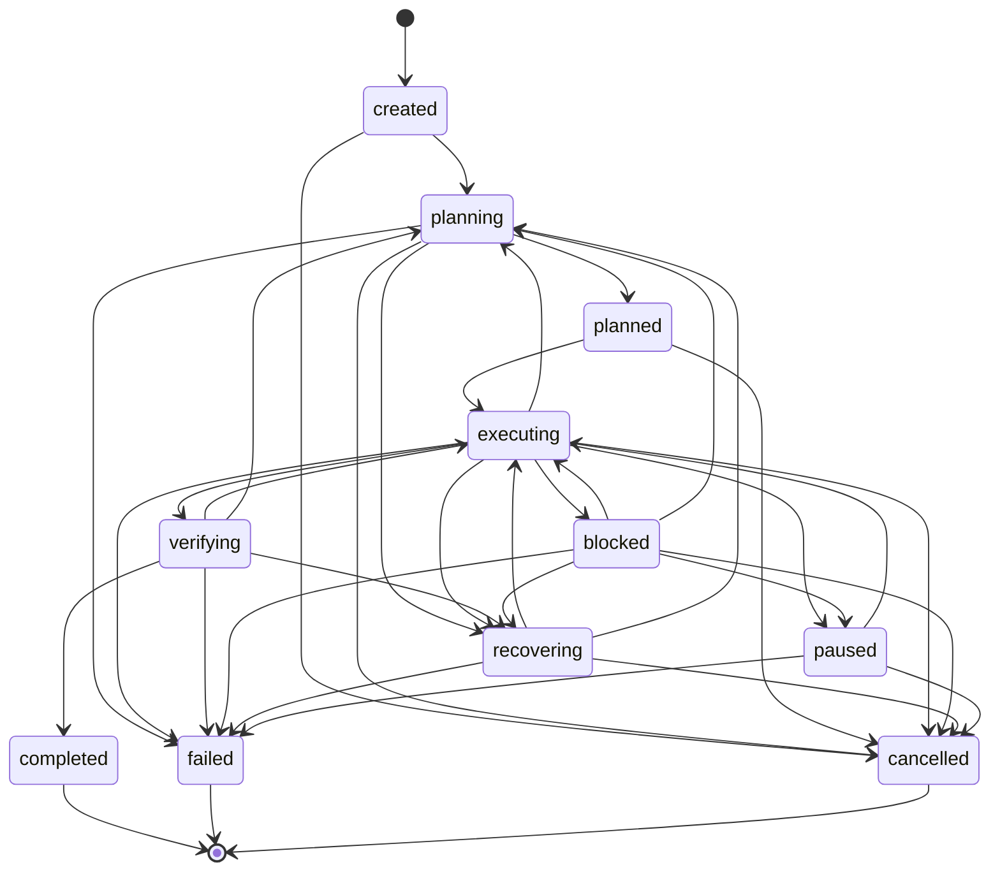

# FORGE STEP 7B — PERSISTENCE & PRODUCTION RUNTIME ARCHITECTURE

**Status:** APPROVED FOR IMPLEMENTATION  
**Version:** 1.0.0  
**Authors:** FORGE Architecture Core & Principal Security Engineering  
**Scope:** Durable State Model, Crash-Safe Persistence, Ledger Durability, 15-Boundary Crash Recovery Matrix, Atomic Checkpoints, Migration & Versioning, and Production Runtime.

---

## 1. EXECUTIVE SUMMARY & INVARIANT OBJECTIVES

Step 7B transitions FORGE from an in-memory execution engine to an industrially crash-safe, durable production runtime.

In FORGE, the fundamental architectural invariant is:
$$\textbf{Model} \to \textbf{Decision} \to \textbf{Autonomy Policy} \to \textbf{Proposal} \to \textbf{Authority Gate} \to \textbf{Capability Host} \to \textbf{Evidence} \to \textbf{Ledger} \to \textbf{Verification} \to \textbf{State}$$

Step 7B establishes two unbreakable physical invariants:
1. **Crash Durability Invariant (INV-19):** No world effect is dispatched before its authorization is durably fsync'd to disk; no state transition is committed before its ledger record is durably fsync'd to disk.
2. **Conservative Recovery Invariant (INV-20):** If execution is interrupted after dispatch but before observation persistence, non-idempotent or unknown side effects **must NEVER silently re-execute**. The state is classified as `post-effect-unknown` and fails closed unless explicitly acknowledged by the operator.

---

## 2. 7B.1 DURABLE STATE MODEL

### 2.1 State Transition Graph

Let $S$ be the finite set of mission states:
$$S = \{\text{created}, \text{planning}, \text{planned}, \text{executing}, \text{verifying}, \text{blocked}, \text{recovering}, \text{paused}, \text{completed}, \text{failed}, \text{cancelled}\}$$

The transition relation $T \subseteq S \times S$ is strictly deterministic and verified by `validateMissionTransition(from, to)`:



### 2.2 Terminal Sink Rule
The states `completed`, `failed`, and `cancelled` are **terminal sinks**:
$$\forall s \in \{\text{completed}, \text{failed}, \text{cancelled}\}, \quad T(s) = \emptyset$$
Any attempt to transition from or append records to a mission in a terminal sink state throws `MissionClosedError` and fails closed before any side effect.

### 2.3 Immutable Plan DAG
1. Plans are versioned: $V_1, V_2, \dots, V_k$.
2. Once proposed (`plan.proposed`) and confirmed (`plan.confirmed`), a Plan is strictly immutable.
3. Every Plan is a Directed Acyclic Graph (DAG) of Milestones and Tasks:
   $$\text{TaskDAG} = (V_{\text{tasks}}, E_{\text{deps}}), \quad \text{Cycles}(E_{\text{deps}}) = \emptyset$$
4. Replanning generates a new Plan version $V_{k+1}$ referencing the previous plan ID, preserving complete audit lineage.

---

## 3. 7B.2 CRASH-SAFE PERSISTENCE & PHYSICAL DURABILITY

### 3.1 Synchronous Physical Flush (`fsync`)
Operating system page cache buffering creates a window where un-flushed writes are lost on power loss.
- **Rule:** `Ledger.append()` must synchronously call `fsyncSync(fd)` (or `fdatasyncSync(fd)`) after writing each record line.
- A record is considered durable **only after `fsyncSync` returns successfully**.
- Memory caches (`this.chain`) are updated **only after** physical disk sync succeeds.

### 3.2 Atomic Multi-File & Artifact Persistence
- Content-addressed artifacts (`artifacts/<sha256>`) are written to a process-unique temporary file (`<sha256>.tmp.<pid>.<rand>`).
- The temporary file is fsync'd and renamed via atomic `renameSync` to the final path.
- Transient Windows file locks (`EPERM`/`EBUSY`) are handled via bounded exponential backoff retries (up to 5 attempts).

### 3.3 Torn Tail Detection & Safe Recovery
If the host process is terminated abruptly (e.g. `SIGKILL` or power outage) during a physical write, the trailing line in `journal.jsonl` may be partially written (a "torn write").
- **Middle Corruption:** If any line $k < N$ is malformed or its hash does not match `prevHash`, it is classified as tampering/disk damage. The mission is quarantined with `JournalCorruptionError` (INV-5).
- **Torn Tail:** If and only if the *last line* $N$ in the file fails JSON decoding, and all prefix records $1 \dots N-1$ form a verified cryptographic hash chain:
  - In normal mode, it raises `JournalCorruptionError`.
  - In explicit recovery mode (`repairTornTail: true`), the runtime truncates the uncommitted partial trailing line back to the last newline byte of line $N-1$, logs a durable audit record of the repair, and successfully recovers the prefix chain.

### 3.4 Crash-Resilient Single-Writer Lock Lease
The mission lock `.lock` holds:
```json
{
  "pid": 1234,
  "host": "builder-node-1",
  "acquiredAt": 1775540000000,
  "heartbeat": 1775540015000
}
```
- Mutex creation uses `openSync(path, "wx")` (atomic creation with `O_EXCL`).
- Running workers update `heartbeat` periodically (every 5 seconds).
- A lock older than `LOCK_STALE_MS` (30 seconds) is classified as a crashed writer and can be safely stolen by a new runner during recovery.

---

## 4. 7B.3 LEDGER DURABILITY & INTEGRITY

### 4.1 Zero-Data-Loss Replay (INV-13)
- `journal.jsonl` is the sole source of truth.
- Auxiliary stores (`projections.db`, memory DAG, in-memory caches) are strictly disposable projections.
- **Proof:** Deleting all auxiliary stores and rebuilding from `journal.jsonl` reproduces identical mission state, active plan, grants, and completed task set.

### 4.2 Cryptographic Hash Chain Verification (INV-5)
Each record satisfies:
$$\text{record}[i].\text{hash} = \text{SHA-256}\left(\text{record}[i].\text{prevHash} \parallel \text{CanonicalJSON}(\text{record}[i] \setminus \{\text{hash}\})\right)$$
With `record[0].prevHash = "0000000000000000000000000000000000000000000000000000000000000000"`.
Any alteration of historical records invalidates all subsequent hashes.

### 4.3 Closure Anchor Durability (F-04)
When a mission closes, `mission.closed` records:
$$\text{receipt}.\text{chainTip} = \text{prevHash of closure record}$$
A journal that ends prematurely or has records appended after `mission.closed` fails validation immediately.

---

## 5. 7B.4 THE 15-BOUNDARY CRASH RECOVERY & IDEMPOTENCY MATRIX

The table below exhaustively specifies every crash boundary across the execution lifecycle:

| Boundary | Crash Location | In-Flight State | Ledger State at Crash | Idempotency Classification | Mechanical Recovery Action |
| :---: | :--- | :--- | :--- | :--- | :--- |
| **B-01** | Prior to proposal generation | Task executing, model reasoning | `task.started` logged; no proposal | Pure Computation (No side effects) | Reset task to `ready`; re-run reasoning turn. |
| **B-02** | Between `proposal.received` and Gate evaluation | Proposal in memory / gate queue | `proposal.received` appended; no validation | Pure State (No side effects) | Proposal re-evaluated at Gate on resume. |
| **B-03** | Between Gate allow verdict and `proposal.dispatched` | Gate allowed; not yet dispatched | `proposal.validated` logged; no dispatch | Pre-Effect (No side effects) | Safe to re-dispatch or re-evaluate. |
| **B-04** | Between `proposal.dispatched` and Capability invocation | Dispatched; host execution pending | `proposal.dispatched` fsync'd; 0 process calls | **Post-Effect-Unknown** | Cannot prove whether process started; requires operator ack if non-idempotent. |
| **B-05** | During Capability execution (subprocess/HTTP active) | Child process running; host crashes | `proposal.dispatched` logged; subprocess dead | **Post-Effect-Unknown** | Subprocess terminated by OS; check filesystem/remote state; require operator ack. |
| **B-06** | Between Capability execution completion and `observation.*` | Subprocess exited; observation in RAM | `proposal.dispatched` logged; no observation | **Post-Effect-Unknown** | Side-effect landed in the real world; requires operator ack to prevent duplicate run. |
| **B-07** | Between `observation.*` and next model reasoning turn | Observation fsync'd; loop restarting | `observation.*` logged; task active | Effect Succeeded | Continue loop; feed observation into model context. |
| **B-08** | During model HTTP stream / token generation | LLM socket open; process killed | Observation logged; no decision | Pure Read (No side effects) | Re-invoke model with accumulated context. |
| **B-09** | Between model response parsing and decision record | Model decision in RAM; uncommitted | No decision record | Pure Computation | Re-invoke model or re-parse decision. |
| **B-10** | Between Task DAG steps ($T_1 \to T_2$) | $T_1$ complete; $T_2$ pending | `task.completed` for $T_1$ logged | Pure State | Scheduler starts next ready task ($T_2$). Exactly-once task completion. |
| **B-11** | During Milestone transition ($M_1 \to M_2$) | All tasks in $M_1$ pass; transition pending | All tasks in $M_1$ complete | Pure State | Scheduler closes $M_1$, creates checkpoint, starts $M_2$. |
| **B-12** | During Checkpoint creation | State snapshot in RAM; record pending | Pre-checkpoint records fsync'd | Pure State | Checkpoint creation re-triggers; previous checkpoint remains valid until committed. |
| **B-13** | During Plan replanning | `plan.proposed` in ledger; unconfirmed | `plan.proposed` logged; no confirmation | Pure State | Active plan remains previous confirmed plan; unconfirmed plan ignored. |
| **B-14** | During Delegation (Child mission running) | Child mission executing in background | `delegation.spawned` logged | Delegated State | Parent inspects child mission ledger; recovers child or awaits completion. |
| **B-15** | During Mission Closure | Verification passed; `mission.closed` pending | All verifications passed | Terminal State | Re-verify criteria from ledger; write `mission.closed` and receipt. |

### 5.1 Conservative Recovery Invariant Rule
$$\text{Classify}(p) = \begin{cases}
\text{replayable} & \text{if } \text{capability} \in \{\text{search}, \text{doc\_parse}, \text{artifact}\} \lor (\text{capability} = \text{fs} \land \text{op} \in \{\text{write}, \text{mkdir}, \text{read}\}) \\
\text{post-effect-unknown} & \text{if } \text{capability} = \text{fs} \land \text{op} \in \{\text{append}, \text{patch}\} \\
\text{post-effect-unknown} & \text{if } \text{capability} \in \{\text{shell}, \text{git}, \text{http}, \text{mcp\_call}\} \\
\text{post-effect-unknown} & \text{if } \text{idempotency} = \text{conditionally\_idempotent} \lor \text{unknown}
\end{cases}$$

---

## 6. 7B.5 ATOMIC CHECKPOINTS

### 6.1 Checkpoint Structure
Each checkpoint is represented by an immutable `checkpoint.created` record:
```json
{
  "checkpointId": "chk_01J9...",
  "state": "executing",
  "planId": "pln_01J9...",
  "milestoneId": "mls_01J9...",
  "activeTaskId": "tsk_01J9...",
  "completedTasks": 4,
  "totalTasks": 10,
  "chainTip": "e3b0c44298fc1c149afbf4c8996fb92427ae41e4649b934ca495991b7852b855",
  "stateHash": "a1b2c3d4..."
}
```

### 6.2 Checkpoint Invariants
1. **Binding:** A checkpoint binds the exact `chainTip` at the time of creation.
2. **Fast Recovery:** On recovery, the engine verifies the `chainTip` against the ledger, restores the completed task map from the checkpoint, and resumes from `activeTaskId` without re-evaluating historical completed tasks.
3. **No Rollback:** Resuming from a checkpoint appends a `mission.resumed` record; it never mutates or deletes historical ledger records.

---

## 7. 7B.6 MIGRATION & VERSIONING

1. **Schema Version Pinning:** Every record belongs to `JOURNAL_SCHEMA_VERSION = 1`.
2. **Version Checking:** On opening a mission, `Ledger` verifies that all records conform to `JOURNAL_SCHEMA_VERSION <= CURRENT_SUPPORTED_VERSION`.
3. **Unsupported Version Defense:** Opening a journal with a higher schema version throws `UnsupportedSchemaVersionError` and fails closed before read or write.

---

## 8. 7B.7 PRODUCTION RUNTIME DAEMON ARCHITECTURE

The production runtime consists of:
1. **`ForgeRuntime`:**
   - Supervises concurrent mission lifecycles.
   - Manages graceful shutdown on `SIGINT` / `SIGTERM` (propagates abort signals to running containers, flushes active appends, cleans up locks).
   - Boot Recovery Sweep: Scans `dataDir/missions` at startup, identifies unclosed missions with stale locks, and initiates recovery.
2. **`MissionDaemon`:**
   - Background worker maintaining active heartbeats on `.lock`.
   - Handles pause, resume, and cancellation commands via API or IPC.

---

*Authored by Principal Security Engineering & Certified by FORGE Architecture Core.*
