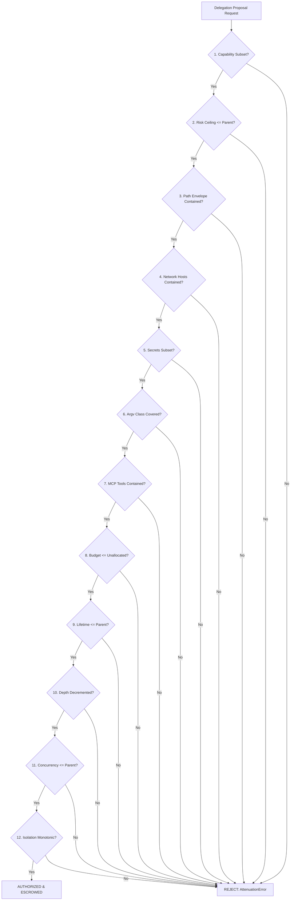

# FORGE STEP 8 — FORMAL AUTHORITY & DELEGATION MODEL

**Status:** MATHEMATICAL & CONTRACT SPECIFICATION  
**Version:** FORGE v1.3-authority-model  
**Authors:** Principal Systems Architect & Security Engineering  
**Prerequisites:** Step 6 (Governance), Step 7A (Sandbox Isolation), Step 7B (Persistence)  

---

## 1. MACHINE-CHECKABLE DELEGATION GRANT SCHEMA

A delegation grant is an immutable data object created by the Authority Gate and committed to the cryptographic ledger. It represents the active authority boundary of a child sub-mission.

```typescript
export const DelegationGrantSchema = z.object({
  // 1. Identity & Lineage
  delegationId: z.string().regex(/^del_[0-9A-HJKMNP-TV-Z]{26}$/, "ULID format"),
  parentMissionId: MissionIdSchema,
  childMissionId: MissionIdSchema,
  parentAgentId: z.string().min(1).max(64),
  childAgentId: z.string().min(1).max(64),
  incarnationId: z.string().min(1).max(36), // UUID per process run
  depth: z.number().int().min(1).max(3),
  parentGrantId: GrantIdSchema, // Bound to parent's specific active grant

  // 2. Capability Envelope (12-Dimensional Attenuation)
  allowedCapabilities: z.array(CapabilityIdSchema).min(1).max(32),
  constraints: ConstraintsSchema,
  riskCeiling: RiskClassSchema, // Maximum permissible risk tier
  isolationProfile: z.enum(["sandboxed", "host"]), // Inherited monotonicity

  // 3. Temporal Bounds
  issuedAt: Iso8601Schema,
  expiresAt: Iso8601Schema, // MUST be <= parent.expiresAt

  // 4. Partitioned Budget Escrow (Hard Upper Bounds)
  budgetEscrow: z.object({
    maxPlannerTurns: z.number().int().min(1).max(50),
    maxModelCalls: z.number().int().min(1).max(100),
    maxTokens: z.number().int().min(1000).max(2_000_000),
    maxCapabilityCalls: z.number().int().min(1).max(100),
    maxRetries: z.number().int().min(0).max(20),
    maxExecutionTimeMs: z.number().int().min(1000).max(3600_000),
    maxArtifactBytes: z.number().int().min(1024).max(100 * 1024 * 1024),
    maxConcurrentTasks: z.number().int().min(1).max(5),
  }),

  // 5. Verification & Receipt Binding
  requiredVerificationTier: z.enum(["mechanical", "adjudicated"]),
  acceptanceCriteria: z.array(CriterionExprSchema).min(1).max(16),
  state: z.enum(["authorized", "active", "suspended", "completed", "failed", "revoked", "expired"]),
}).strict();

export type DelegationGrant = z.infer<typeof DelegationGrantSchema>;
```

### 1.1 Field Justifications & Security Rationale
- **`incarnationId`:** Binds authority to a single physical process/container run. If a child agent crashes, an adversary re-attaching or a resurrected process cannot execute using an old incarnation token.
- **`parentGrantId`:** Cryptographically binds child authority to a *specific* active parent grant. If the parent grant is revoked or superseded, all child grants citing it are invalidated immediately.
- **`budgetEscrow`:** Explicit hard allocations deducted directly from parent unallocated pools. Prevents concurrent sibling overdraw attacks.
- **`acceptanceCriteria`:** Pre-declared verification rules. The parent cannot arbitrarily move the goalposts, and the child cannot forge arbitrary completion proofs.

---

## 2. THE 12-DIMENSIONAL AUTHORITY ATTENUATION THEOREM

$$\mathbf{A}_{\text{child}} \subseteq \mathbf{A}_{\text{parent}} \iff \bigwedge_{i=1}^{12} \text{DimensionValid}_i(\mathbf{A}_{\text{parent}}, \mathbf{A}_{\text{child}})$$

Any violation of any single dimension halts delegation authorization with an immediate `AttenuationError`.



### Dimension Specifications:

1. **Capability Namespace Containment:**
   $$\text{Caps}_{\text{child}} \subseteq \text{Caps}_{\text{parent}}$$
   Every requested capability name in child grant must exist in parent's active capability set.
2. **Risk Ceiling Monotonicity:**
   $$\text{Rank}(\text{Risk}_{\text{child}}) \le \text{Rank}(\text{Risk}_{\text{parent}}) \quad (\text{read} < \text{write} < \text{execute} < \text{network} < \text{secret})$$
3. **Filesystem Path Containment:**
   $$\forall p_c \in \text{Paths}_{\text{child}}, \quad \exists p_p \in \text{Paths}_{\text{parent}} : \text{PathPrefix}(p_c) \subseteq \text{PathPrefix}(p_p)$$
   Child paths must be sub-directories of parent authorized paths. Path traversal (`..`) and symlink escapes are evaluated against canonical physical realpaths.
4. **Network Host & Method Containment:**
   $$\text{Hosts}_{\text{child}} \subseteq \text{Hosts}_{\text{parent}} \quad \land \quad \text{Methods}_{\text{child}} \subseteq \text{Methods}_{\text{parent}}$$
5. **Secret Name Containment:**
   $$\text{Secrets}_{\text{child}} \subseteq \text{Secrets}_{\text{parent}}$$
   An ungranted secret name in parent cannot be delegated to a child.
6. **Argv Class Coverage:**
   $$\text{argvClassCovers}(\text{parent}.\text{argvClass}, \text{child}.\text{argvClass}) = \text{true}$$
   Exact commands cover identical or prefix commands; `argv-prefix` covers longer prefix; regex anchors must match identically. Widening from exact to prefix is blocked.
7. **MCP Tool & Server Containment:**
   $$\text{McpServers}_{\text{child}} \subseteq \text{McpServers}_{\text{parent}} \quad \land \quad \text{McpTools}_{\text{child}} \subseteq \text{McpTools}_{\text{parent}}$$
8. **Budget Escrow Inequality:**
   $$\forall \text{metric } m \in \text{Budget}: \quad \text{ChildEscrow}(m) \le \text{ParentUnallocatedRemaining}(m)$$
9. **Lifetime Expiration Monotonicity:**
   $$\text{child}.\text{expiresAt} \le \text{parent}.\text{expiresAt}$$
   If parent expiration is non-null, child expiration must be non-null and occur before or at parent expiration.
10. **Delegation Depth Decrement:**
    $$\text{child}.\text{depth} = \text{parent}.\text{depth} + 1 \le D_{\max}$$
11. **Concurrency Monotonicity:**
    $$\text{child}.\text{maxConcurrentTasks} \le \text{parent}.\text{maxConcurrentTasks}$$
12. **Isolation Strictness Monotonicity:**
    $$\text{Strictness}(\text{Isolation}_{\text{child}}) \ge \text{Strictness}(\text{Isolation}_{\text{parent}})$$
    If parent is `sandboxed`, child **MUST** be `sandboxed`. Only if parent possesses an active `allowHostExecution` grant may child be granted `host` isolation.

---

## 3. HIERARCHICAL BUDGET ESCROW & ACCOUNTING MODEL

In a multi-agent system, naive budget tracking where agents freely pull from a shared parent counter leads to **concurrency double-spending** and **race conditions**.

### 3.1 The Conservation Law
For every budget dimension $m$ (tokens, turns, capability calls, wall-clock ms):
$$\text{TotalAllocated}(m) = \text{ParentConsumed}(m) + \sum_{c \in \text{Children}} \text{ChildEscrow}_c(m) + \text{UnallocatedRemaining}(m)$$

$$\text{UnallocatedRemaining}(m) \ge 0 \quad \text{at all times}$$

### 3.2 Escrow Mechanics
1. **Durable Reservation on Authorization:**
   When Parent authorizes Child $C$, `ChildEscrow(m)` is instantly deducted from `Parent.Unallocated(m)`. This deduction is committed to the parent journal via `delegation.authorized` before the child process is spawned.
2. **No Sibling Borrowing / No Cross-Transfers:**
   Child $C_1$ cannot borrow budget from Child $C_2$. Child $C_1$ has access strictly to its own escrow allocation $\text{ChildEscrow}_1$.
3. **Escrow Reclamation on Terminal Exit:**
   When Child $C$ reaches a terminal state (`completed`, `failed`, `revoked`, `expired`):
   $$\text{UnusedBudget}_c = \text{ChildEscrow}_c - \text{ChildActualConsumed}_c$$
   $$\text{Parent.Unallocated} \leftarrow \text{Parent.Unallocated} + \text{UnusedBudget}_c$$
   $$\text{Parent.Consumed} \leftarrow \text{Parent.Consumed} + \text{ChildActualConsumed}_c$$
   This reconciliation is committed to the parent ledger via `delegation.reconciled`.
4. **Provider Retries & Failovers:**
   When model calls fail with 429 RateLimit or transport errors and trigger router failovers, all tokens consumed across failed attempts are debited to the child's escrow. Retries stop immediately when escrow is exhausted.

---

## 4. STABLE AGENT IDENTITY & INCARNATION SECURITY

An agent in FORGE is never identified merely by display name, model name, or OS process PID.

### 4.1 Cryptographic Identity 6-Tuple
$$\text{AgentIdentity} = \langle \text{agentId}, \text{missionId}, \text{delegationId}, \text{incarnationId}, \text{parentAgentId}, \text{creationSeq} \rangle$$

- **`agentId`:** Globally unique ULID string (`agt_01J...`).
- **`missionId`:** Unique sub-mission identifier (`mis_01J...`).
- **`delegationId`:** Authorization grant identifier (`del_01J...`).
- **`incarnationId`:** UUID regenerated on every single process start or restart.
- **`parentAgentId`:** Immutable link to parent delegator.
- **`creationSeq`:** Sequence number of `delegation.authorized` in parent journal.

### 4.2 Anti-Resurrection Rule
If child agent process dies, crashes, or is restarted:
- The previous `incarnationId` is permanently invalidated.
- An attacker possessing a memory dump or historical socket token from incarnation 1 cannot submit capability proposals or receipts to incarnation 2.
- The Authority Gate checks `activeIncarnation === request.incarnationId`. Stale incarnations fail authorization immediately.

---

*Authored by Principal Systems Architect & Security Engineering.*
