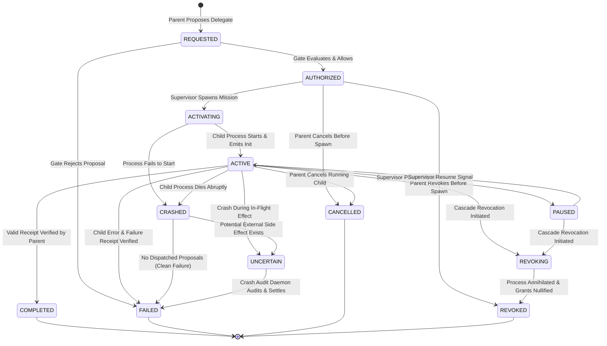

# FORGE STEP 8 PHASE 2 — STATE MACHINE SPECIFICATION
## Formal Lifecycle State Machine for Multi-Agent Delegations

**Document:** Delegation State Machine Specification — Step 8 Phase 2  
**Status:** SPECIFICATION COMPLETE  
**Version:** FORGE v1.4-step8-phase2-state-machine  
**Date:** 2026-10-07  
**Scope:** 12 Delegation Lifecycle States, Transitions, Actors, and Recovery Semantics  

---

## 1. STATE DEFINITIONS

The Multi-Agent Delegation lifecycle comprises exactly **12 formal states**:

| State | Classification | Description |
|---|---|---|
| **`REQUESTED`** | Transient | Parent planner has proposed a delegation; proposal is pending Authority Gate evaluation. |
| **`AUTHORIZED`** | Durable | Gate has approved delegation proposal; budget escrowed; recorded in parent journal; awaiting runtime spawn. |
| **`ACTIVATING`** | Intermediate | Host Supervisor is initializing child mission directory, workspace mount, and launching child process. |
| **`ACTIVE`** | Operational | Child process is running, registered in projection, and actively dispatching governed proposals. |
| **`PAUSED`** | Operational | Child execution temporarily suspended by supervisor (e.g. rate limit backoff or human review). |
| **`REVOKING`** | Intermediate | Revocation initiated by parent or supervisor; SIGKILL dispatched to child process tree; awaiting termination. |
| **`REVOKED`** | **Terminal** | Child process terminated; grants invalidated; remaining escrow refunded; permanently closed. |
| **`COMPLETED`** | **Terminal** | Child completed task; receipt generated, cryptographically verified by parent, and budget settled. |
| **`FAILED`** | **Terminal** | Child planner encountered unrecoverable error or violated constraint; verified failure receipt ingested. |
| **`CANCELLED`** | **Terminal** | Parent cancelled delegation before child completion; child terminated; partial budget settled. |
| **`CRASHED`** | Intermediate | Child process terminated abruptly without receipt; awaiting Crash Audit Daemon sweep. |
| **`UNCERTAIN`** | Quarantine | Crash occurred during potential external side effect; budget frozen; requires audit before settlement. |

---

## 2. STATE TRANSITION DIAGRAM

---

## 3. FORMAL TRANSITION TABLE

| From State | To State | Trigger Event / Actor | Preconditions Checked | Journal Record Emitted | Target Classification |
|---|---|---|---|---|---|
| `[*]` | `REQUESTED` | Parent Model / Planner | Valid `delegate` proposal schema | `proposal.created` | Transient |
| `REQUESTED` | `AUTHORIZED` | Parent Authority Gate | Attenuation ok, topology bounds ok, budget CAS ok | `delegation.authorized` | Durable |
| `REQUESTED` | `FAILED` | Parent Authority Gate | Attenuation fails, bounds exceeded, or budget exhausted | `proposal.rejected` | Terminal |
| `AUTHORIZED` | `ACTIVATING` | Host Supervisor | Child mission directory created, workspace jail mounted | `delegation.activated` | Intermediate |
| `AUTHORIZED` | `REVOKED` | Parent Planner / Supervisor | Explicit revocation signal received before spawn | `delegation.revoked` | Terminal |
| `AUTHORIZED` | `CANCELLED` | Parent Planner | Task abort or DAG cancellation | `delegation.cancelled` | Terminal |
| `ACTIVATING` | `ACTIVE` | Child Runtime Host | Child process alive, initial epoch registered | `delegation.active` | Operational |
| `ACTIVATING` | `CRASHED` | Host Supervisor | Child process exited with non-zero or timed out on boot | `child.spawn_failed` | Intermediate |
| `ACTIVE` | `PAUSED` | Host Supervisor / Operator | Human-in-the-loop pause or provider rate limit | `delegation.paused` | Operational |
| `PAUSED` | `ACTIVE` | Host Supervisor / Operator | Rate limit cleared or operator unpauses | `delegation.resumed` | Operational |
| `ACTIVE` | `REVOKING` | Parent / Supervisor / Gate | Parent revoked, ancestor revoked, or policy breach | `delegation.revoking` | Intermediate |
| `PAUSED` | `REVOKING` | Parent / Supervisor / Gate | Ancestor revocation while paused | `delegation.revoking` | Intermediate |
| `REVOKING` | `REVOKED` | Host Supervisor | Process tree confirmed killed via OS Job Object / cgroup | `delegation.revoked` | Terminal |
| `ACTIVE` | `COMPLETED` | Parent Receipt Verifier | Receipt hash-chain verified, evidence verified, budget settled | `delegation.receipt_verified` | Terminal |
| `ACTIVE` | `FAILED` | Parent Receipt Verifier | Error receipt verified, remaining budget refunded | `delegation.receipt_rejected` | Terminal |
| `ACTIVE` | `CANCELLED` | Parent Planner / Supervisor | Graceful cancellation requested and acknowledged | `delegation.cancelled` | Terminal |
| `ACTIVE` | `CRASHED` | Crash Recovery Sweep | Child process missing from OS table; heartbeat lost | `child.crash_detected` | Intermediate |
| `ACTIVE` | `UNCERTAIN` | Crash Recovery Sweep | Child crashed with dispatched proposal lacking observation | `child.effect_uncertain` | Quarantine |
| `CRASHED` | `UNCERTAIN` | Crash Audit Daemon | Proposal was dispatched before crash | `budget.escrow_uncertain` | Quarantine |
| `CRASHED` | `FAILED` | Crash Audit Daemon | No dispatched proposal in child journal; pure crash | `delegation.closed` | Terminal |
| `UNCERTAIN` | `FAILED` | Crash Audit Daemon | Audited reconciliation completed; partition committed | `delegation.budget_reconciled` | Terminal |

---

## 4. FORBIDDEN TRANSITIONS (STRICT FAIL-CLOSED RULES)

1. **NO TERMINAL STATE MAY BE REOPENED:**
   - `COMPLETED` $\to$ `ACTIVE` : **FORBIDDEN** (Prevents task re-execution after completion).
   - `REVOKED` $\to$ `ACTIVE` : **FORBIDDEN** (Prevents revoked agent resurrection).
   - `FAILED` $\to$ `ACTIVE` : **FORBIDDEN** (Requires new delegation and new ID).
   - `CANCELLED` $\to$ `ACTIVE` : **FORBIDDEN** (Terminal state is final).
2. **NO BYPASS OF AUTHORIZATION:**
   - `REQUESTED` $\to$ `ACTIVE` : **FORBIDDEN** (Bypasses Authority Gate and budget escrow).
   - `REQUESTED` $\to$ `ACTIVATING` : **FORBIDDEN** (Must commit `delegation.authorized` first).
3. **NO DIRECT JUMP TO COMPLETED WITHOUT VERIFICATION:**
   - `ACTIVATING` $\to$ `COMPLETED` : **FORBIDDEN** (Child cannot complete without executing).
   - `CRASHED` $\to$ `COMPLETED` : **FORBIDDEN** (Crashed child cannot be marked successful).
   - `UNCERTAIN` $\to$ `COMPLETED` : **FORBIDDEN** (Uncertain state can only resolve to FAILED / AUDITED).
4. **NO AUTO-REFUND OF UNCERTAIN SPEND:**
   - `UNCERTAIN` $\to$ `AVAILABLE` : **FORBIDDEN** (Direct refund throws `UncertainBudgetRefundError`).

---

## 5. RECOVERY BEHAVIOR FOR EACH STATE UPON CRASH

| State at Crash Time | Recovery Sweep Action | Resulting State | Budget Impact |
|---|---|---|---|
| `REQUESTED` | Discard in-memory request. No journal record committed. | Non-existent | Zero budget impact. |
| `AUTHORIZED` | Inspect if child mission directory exists. If not, re-trigger activation or cancel. | `ACTIVATING` or `CANCELLED` | Escrow preserved. |
| `ACTIVATING` | Check OS process table. If dead, transition to `CRASHED`. | `CRASHED` | Escrow preserved. |
| `ACTIVE` | Check child journal: if clean tip, transition to `CRASHED`. If in-flight proposal, transition to `UNCERTAIN`. | `CRASHED` / `UNCERTAIN` | Escrow marked uncertain if in-flight. |
| `PAUSED` | Child was suspended; process is dead on restart. Transition to `CRASHED`. | `CRASHED` | Escrow preserved. |
| `REVOKING` | Ensure OS process tree is terminated. Finalize revocation. | `REVOKED` | Escrow refunded to parent. |
| `REVOKED` | Already terminal. No action needed. | `REVOKED` | Finalized. |
| `COMPLETED` | Already terminal. Verified receipt recorded. | `COMPLETED` | Finalized. |
| `FAILED` | Already terminal. | `FAILED` | Finalized. |
| `CANCELLED` | Already terminal. | `CANCELLED` | Finalized. |
| `CRASHED` | Evaluate child journal for unobserved proposals. | `UNCERTAIN` or `FAILED` | Escrow partitioned or frozen. |
| `UNCERTAIN` | Retain in quarantine. Escalate to Crash Audit Daemon. | `UNCERTAIN` | Frozen until audited. |
