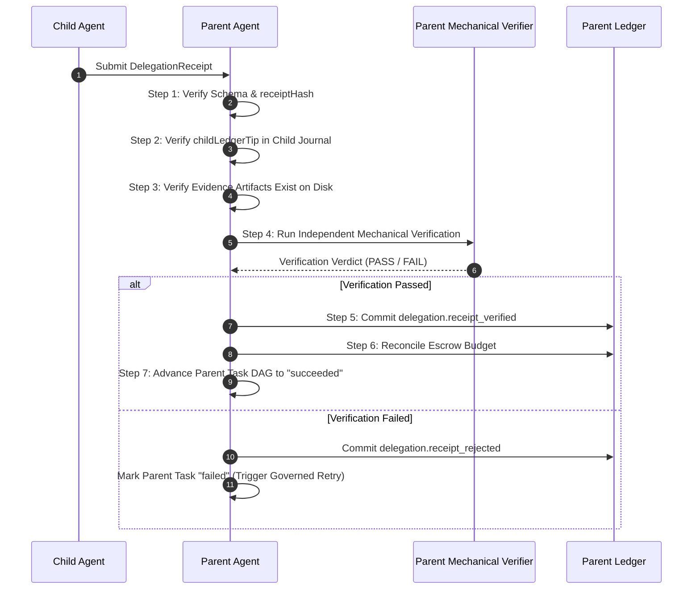

# FORGE STEP 8 — DELEGATION RECEIPT PROTOCOL & PLAN ISOLATION

**Status:** PROTOCOL SPECIFICATION  
**Version:** FORGE v1.3-receipt-protocol  
**Authors:** Principal Systems Architect & Security Engineering  
**Prerequisites:** Step 6 (Governance), Step 7A (Sandbox Isolation), Step 7B (Persistence)  

---

## 1. PARENT / CHILD PLAN ISOLATION

In a multi-agent hierarchy, child agents must **NEVER directly mutate parent mission state, milestones, or task DAG queues**.

```text
❌ FORBIDDEN: Direct Mutation
Child Agent ─────────(Direct Method Call)─────────▶ Parent Mission State / DAG Queue

🟢 MANDATORY: Governed Receipt & Verification
Child Agent
     │
     ▼
[Execution Evidence Artifacts (Content-Addressed)]
     │
     ▼
[Cryptographic Delegation Receipt]
     │
     ▼
Parent Ingestion Gate
     │
     ▼
Parent Mechanical Verification Engine
     │
     ▼
[Budget Reconciliation & Ledger Commit]
     │
     ▼
Parent Mission State / DAG Advance
```

### 1.1 The Non-Trust Rule
**Can the parent trust a child's message that a task is "completed"?**
**NO.** The child agent is driven by an untrusted LLM token stream. LLMs regularly hallucinate task completion, report success when sub-commands failed with non-zero exit codes, or omit critical output files.

Parent task progression is driven **exclusively by mechanical verification of physical artifacts and cryptographic journal proofs**, never by textual agent affirmations.

---

## 2. DELEGATION RECEIPT SCHEMA

A `DelegationReceipt` is a content-addressed, machine-verifiable proof of execution delivered from the child sub-mission to the parent orchestrator:

```typescript
export const DelegationReceiptSchema = z.object({
  // 1. Identity & Lineage
  receiptId: z.string().regex(/^rcp_[0-9A-HJKMNP-TV-Z]{26}$/, "ULID format"),
  delegationId: z.string().regex(/^del_[0-9A-HJKMNP-TV-Z]{26}$/),
  parentMissionId: MissionIdSchema,
  childMissionId: MissionIdSchema,
  childAgentId: z.string().min(1).max(64),
  parentTaskId: z.string().min(1).max(64), // Parent DAG task fulfilled

  // 2. Cryptographic Journal Anchor
  childLedgerTip: Sha256HexSchema, // Final SHA-256 hash of child's journal.jsonl
  childRecordCount: z.number().int().min(1),

  // 3. Content-Addressed Evidence
  evidenceRefs: z.array(Sha256HexSchema).min(1).max(64), // Artifact hashes produced

  // 4. Exact Audited Budget Consumption
  budgetConsumed: z.object({
    plannerTurns: z.number().int().min(0),
    modelCalls: z.number().int().min(0),
    tokensIn: z.number().int().min(0),
    tokensOut: z.number().int().min(0),
    capabilityCalls: z.number().int().min(0),
    retries: z.number().int().min(0),
    executionTimeMs: z.number().int().min(0),
    artifactBytes: z.number().int().min(0),
  }),

  // 5. Execution Outcome & Self-Verification Claims
  status: z.enum(["succeeded", "failed", "inconclusive"]),
  failureDiagnosis: TaskFailureRecordSchema.nullable().default(null),
  completedAt: Iso8601Schema,

  // 6. Receipt Digest
  receiptHash: Sha256HexSchema, // SHA-256(canonicalJson(receipt fields 1..5))
}).strict();

export type DelegationReceipt = z.infer<typeof DelegationReceiptSchema>;
```

### 2.1 Efficiency & Anti-Bloat Strategy
To prevent duplicated monolithic receipts that bloat parent ledgers:
- **No Payload Duplication:** The receipt contains **zero raw payload bytes**. It references artifact SHA-256 hashes (`evidenceRefs`). The actual bytes reside in content-addressed storage (`artifacts/<hash>`).
- **Single Tip Anchor:** The receipt stores a single 64-character hex hash (`childLedgerTip`). If the parent needs to audit individual child steps, it traverses the child's sub-journal anchored by that tip.

---

## 3. SEVEN-STEP RECEIPT VERIFICATION PROCEDURE

When a child delivers a `DelegationReceipt` to the parent mission:



### 3.1 Step Details:
1. **Schema & Hash Validation:**
   - Verify all fields conform to `DelegationReceiptSchema`.
   - Compute `SHA-256(canonicalJson(receipt - {receiptHash}))`. Assert computed hash equals `receipt.receiptHash`.
2. **Child Ledger Anchor Verification (INV-27):**
   - Open child mission journal at `dataDir/missions/<childMissionId>/journal.jsonl`.
   - Read last line and verify hash equals `receipt.childLedgerTip`.
   - If child journal hash chain is invalid or does not match `childLedgerTip`, reject receipt immediately as forged (`MA-009`).
3. **Artifact Existence & Integrity:**
   - For every hash in `receipt.evidenceRefs`:
     - Assert file exists in `artifacts/<hash>`.
     - Read bytes, compute SHA-256, assert matches hash.
4. **Independent Parent Mechanical Verification:**
   - Execute parent verification strategy declared in parent plan (e.g. running test command in parent container, checking file existence, regex matching).
   - Zero trust in child's self-reported success.
5. **Ledger Commitment:**
   - Append `delegation.receipt_verified` to parent journal with `fsyncSync()`.
6. **Budget Reconciliation:**
   - Deduct `receipt.budgetConsumed` from child escrow.
   - Return unused escrow balance to parent unallocated pool.
   - Record `delegation.budget_reconciled` in parent journal.
7. **Parent DAG Progression:**
   - Transition parent task status from `running` to `succeeded`.
   - Scheduler evaluates ready queue and promotes dependent tasks.

---

*Authored by Principal Systems Architect & Security Engineering.*
