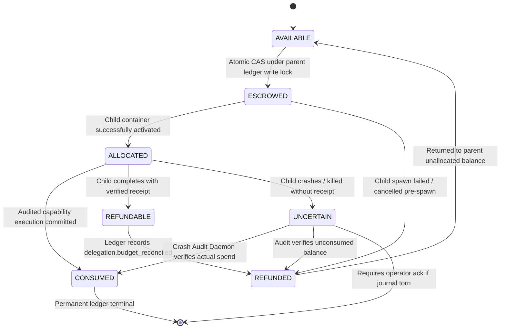

# FORGE STEP 8 — REMEDIATED HIERARCHICAL BUDGET ESCROW MODEL

**Document:** Formal Specification — Remediated Budget Conservation, Concurrency CAS & Crash Accounting  
**Status:** REMEDIATED ARCHITECTURAL SPECIFICATION  
**Version:** FORGE v1.3-remediated-budget  
**Date:** 2026-10-07  
**Remediates:** Finding S8-06 (High), Finding S8-10 (Medium)  
**Authors:** Principal Security Architect & Adversarial Engineering  

---

## 1. THE SEVEN-STATE BUDGET ACCOUNTING MODEL

To eliminate concurrency double-spending and un-audited budget leaks, every unit of budget exists in exactly one of seven mutually exclusive states:



### 1.1 State Definitions
1. **`AVAILABLE`:** Unallocated parent balance eligible for new delegation grants or parent direct execution.
2. **`ESCROWED`:** Deducted from parent `AVAILABLE` balance and locked for child delegation authorization before spawn.
3. **`ALLOCATED`:** Child sub-mission container spawned and running; budget active in child execution context.
4. **`CONSUMED`:** Irrevocably spent on verified LLM tokens, model API calls, or capability execution dispatches.
5. **`REFUNDABLE`:** Unspent child escrow verified via receipt or post-crash journal audit.
6. **`REFUNDED`:** Recredited to parent `AVAILABLE` pool via committed ledger record.
7. **`UNCERTAIN` (Remediates S8-06):** Child container terminated or crashed before receipt delivery; actual spend unverified. **Automatic refund strictly forbidden.**

---

## 2. THE CONSERVATION LAW

For every budget metric $m \in \{ \text{tokens}, \text{modelCalls}, \text{capabilityCalls}, \text{executionTimeMs}, \text{artifactBytes} \}$:

$$\text{TotalLimit}(m) = \text{Consumed}_P(m) + \sum_{c \in \text{Children}} \text{Escrow}_c(m) + \text{Available}_P(m)$$

Where:
$$\text{Escrow}_c(m) = \text{Allocated}_c(m) + \text{Uncertain}_c(m) + \text{Refundable}_c(m) + \text{Consumed}_c(m)$$

$$\text{Available}_P(m) \ge 0 \quad \text{at all times } t$$

Double-spending is structurally blocked because the parent `Available` pool is decremented **before** child container spawn.

---

## 3. RESOLUTION OF S8-10: ATOMIC CAS UNDER PARENT WRITE LOCK

To eliminate the TOCTOU race where concurrent parent tasks evaluate proposals against stale in-memory balances:

```typescript
export interface BudgetReservationResult {
  ok: boolean;
  reservationId?: string;
  remainingAvailable: number;
  reason?: string;
}

export function atomicReserveEscrow(
  ledger: Ledger,
  currentProjections: MissionProjections,
  requested: DelegationBudget,
): BudgetReservationResult {
  // 1. Acquire exclusive write lock on parent mission journal
  return ledger.withLock(() => {
    // 2. Re-read authoritative ledger projections under lock
    const available = currentProjections.budget.availableTokens;
    if (requested.maxTokens > available) {
      return { ok: false, remainingAvailable: available, reason: "InsufficientAvailableBudget" };
    }

    // 3. Check active fanout limit under lock
    const activeChildren = currentProjections.activeDelegationsCount;
    if (activeChildren + 1 > currentProjections.maxFanout) {
      return { ok: false, remainingAvailable: available, reason: "MaxFanoutExceeded" };
    }

    // 4. Atomically commit delegation.authorized with escrow deduction
    ledger.appendRecord({
      kind: "delegation.authorized",
      body: {
        delegationId: newDelegationId(),
        budgetEscrow: requested,
        newAvailableTokens: available - requested.maxTokens,
      },
    });

    return { ok: true, remainingAvailable: available - requested.maxTokens };
  });
}
```

By performing the read, threshold check, fanout validation, and append **within the atomic `ledger.withLock()` critical section**, competing parent tasks are serialized. The second task observes the updated remaining balance and fails cleanly if funds are insufficient.

---

## 4. RESOLUTION OF S8-06: CRASH AUDIT DAEMON & UNCERTAIN SPEND RECONCILIATION

When a child container crashes, is killed, or terminates without delivering a `DelegationReceipt`:

### 4.1 The Non-Refund Rule
**No automatic full refund may occur when child actual spend is UNCERTAIN.**
Refunding the full escrow without verifying actual consumption enables budget under-reporting and allows cumulative system spend to exceed the hard limit.

### 4.2 Crash Audit Procedure
1. **Transition to UNCERTAIN:** When `ForgeRuntime` detects child container exit without receipt, the delegation status transitions to `post_effect_unknown`, and escrow moves to `UNCERTAIN`.
2. **Journal Ingestion & Chain Verification:** The host **Crash Audit Daemon** acquires the dead child's journal lock and runs `verifyChain()` on `dataDir/missions/<childMissionId>/journal.jsonl`.
3. **Audited Tally:**
   - Sums all input/output tokens in committed `proposal.dispatched` / `observation.*` records.
   - Sums all capability calls in committed `observation.*` records.
   - Let this audited sum be $\text{ActualSpent}_c$.
4. **Deterministic Partitioning:**
   $$\text{Consumed}_c \leftarrow \text{ActualSpent}_c$$
   $$\text{Refundable}_c \leftarrow \text{Escrow}_c - \text{ActualSpent}_c$$
5. **Reconciliation Ledger Commit:**
   The host daemon appends `delegation.budget_reconciled` to the parent journal:
   - Debits $\text{Consumed}_c$ to `Parent.Consumed`.
   - Credits $\text{Refundable}_c$ to `Parent.Available`.
   - Clears `UNCERTAIN` balance.
6. **Torn Tail or Corrupted Journal Exception:**
   If the child journal is torn or corrupted:
   - Daemon repairs torn uncommitted lines per INV-13.
   - If mid-journal corruption exists, the entire escrow is quarantined in `UNCERTAIN`.
   - Automatic refund is halted; operator intervention is flagged.

---

*Authored by Principal Security Architect & Adversarial Engineering.*
