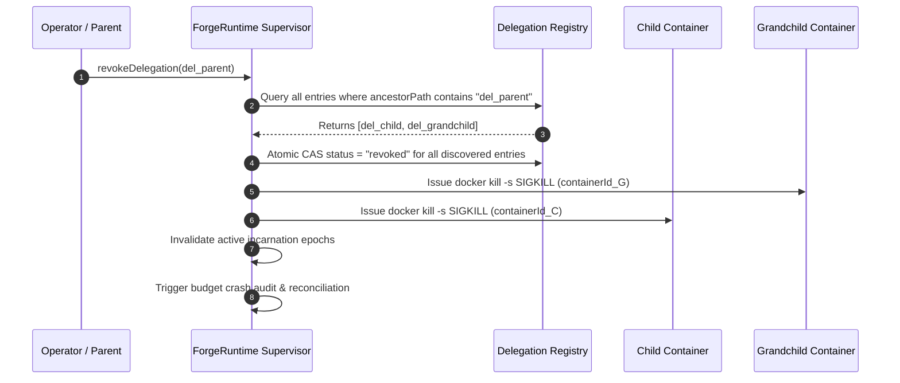

# FORGE STEP 8 — REMEDIATED DELEGATION AUTHORITY REGISTRY

**Document:** System Specification — Host-Authoritative Delegation & Lineage Registry  
**Status:** REMEDIATED ARCHITECTURAL SPECIFICATION  
**Version:** FORGE v1.3-remediated-registry  
**Date:** 2026-10-07  
**Remediates:** Finding S8-04 (Critical), Finding S8-08 (High)  
**Authors:** Principal Security Architect & Adversarial Engineering  

---

## 1. THE PROBLEM: OPTION B GRANDCHILD ISOLATION VS. GOVERNANCE

Under Ledger Architecture Option B (Independent Sub-Ledgers), each child mission writes to its own isolated journal (`dataDir/missions/mis_child/journal.jsonl`). While this provides excellent write lock independence and crash fault containment, it created a critical security vulnerability (**Finding S8-04**):
- When Child $C$ delegates to Grandchild $G$, the delegation record was previously written only to Child $C$'s private journal.
- The parent mission ledger had zero knowledge of Grandchild $G$.
- When Parent $P$ or an Operator revoked Child $C$, cascade revocation traversing Parent $P$'s ledger could not discover Grandchild $G$, leaving $G$ executing as an unmonitored zombie container.

Furthermore, **Finding S8-08** revealed a structural contradiction: if Child $C$'s container has zero filesystem or memory access to Parent $P$'s store (INV-26), Child $C$ cannot synchronously verify Parent $P$'s revocation state on pre-dispatch.

---

## 2. THE SOLUTION: SUPERVISOR-HOSTED DELEGATION AUTHORITY REGISTRY

FORGE preserves Option B's independent journals while introducing a **Host-Authoritative Central Delegation Registry** managed exclusively by the `ForgeRuntime` supervisor process on the trusted host:

```text
                             FORGERUNTIME (HOST SUPERVISOR)
                     ┌──────────────────────────────────────────────┐
                     │    CENTRAL DELEGATION AUTHORITY REGISTRY     │
                     │  (Durable Host Lineage Table: registry.db)   │
                     └──────────────────────┬───────────────────────┘
                                            │
               ┌────────────────────────────┼────────────────────────────┐
               ▼                            ▼                            ▼
        ROOT MISSION                  CHILD SUB-MISSION            GRANDCHILD SUB-MISSION
     journal.jsonl (Host)         journal.jsonl (Sandbox)       journal.jsonl (Sandbox)
     [Isolated Write Lock]         [Isolated Write Lock]         [Isolated Write Lock]
```

### 2.1 Separation of Concerns
1. **Child Sub-Journals:** Record internal execution events, reasoning traces, local proposals, and capability observations within the sub-mission.
2. **Central Delegation Registry:** Authoritative cross-mission registry tracking all active delegations, ancestral parent-child links, container process IDs, active incarnation epochs, and revocation states across the entire tree.
3. **No Direct Container Access:** Sandboxed containers possess **zero direct filesystem or IPC access** to the registry file. The registry is accessible solely via the host supervisor's Capability Host dispatcher over the secure host domain socket.

---

## 3. REGISTRY DATA CONTRACT & DURABLE SCHEMA

The registry is maintained in `dataDir/governance/delegation-registry.json` (with atomic rename and fsync durability):

```typescript
export const DelegationRegistryEntrySchema = z.object({
  // Lineage & Hierarchy
  delegationId: z.string().regex(/^del_[0-9A-HJKMNP-TV-Z]{26}$/),
  parentDelegationId: z.string().regex(/^del_[0-9A-HJKMNP-TV-Z]{26}$/).nullable(),
  rootMissionId: MissionIdSchema,
  parentMissionId: MissionIdSchema,
  childMissionId: MissionIdSchema,
  parentAgentId: z.string().min(1).max(64),
  childAgentId: z.string().min(1).max(64),
  depth: z.number().int().min(1).max(3),
  ancestorPath: z.array(z.string()).min(1).max(4), // Array of delegation IDs to root

  // Process & Container Binding
  childIncarnationEpoch: z.number().int().min(1),
  containerId: z.string().min(1).max(128).nullable(),
  hostPid: z.number().int().nullable(),

  // Authority Envelope & Cryptographic Binding
  grantId: GrantIdSchema,
  grantRevision: z.number().int().min(1),
  effectiveAuthorityHash: Sha256HexSchema, // SHA-256 of EffectiveAuthorityEnvelope

  // Status & Temporal Lifecycle
  status: z.enum([
    "authorized",
    "active",
    "suspended",
    "completed",
    "failed",
    "revoked",
    "expired",
    "post_effect_unknown",
  ]),
  issuedAt: Iso8601Schema,
  expiresAt: Iso8601Schema.nullable(),
  revokedAt: Iso8601Schema.nullable(),
  revocationReason: z.string().nullable().default(null),

  // Escrow Accounting Snapshot
  budgetEscrow: z.object({
    maxTokens: z.number().int(),
    maxCapabilityCalls: z.number().int(),
    maxModelCalls: z.number().int(),
    maxExecutionTimeMs: z.number().int(),
  }),
}).strict();

export type DelegationRegistryEntry = z.infer<typeof DelegationRegistryEntrySchema>;
```

---

## 4. RESOLUTION OF S8-04: DETERMINISTIC DESCENDANT DISCOVERY & CASCADE REVOCATION

When an Operator or Parent Agent revokes Delegation $D$:



### 4.1 Step-by-Step Cascade Procedure
1. **Ancestral Query:** `ForgeRuntime` executes an index query on the registry:
   $$\text{Descendants}(D) = \{ d \in \text{Registry} \mid D \in d.\text{ancestorPath} \lor d.\text{delegationId} = D \}$$
2. **Atomic Status Update:** Under the registry lock, all entries in $\text{Descendants}(D)$ with status $\in \{ \text{"authorized"}, \text{"active"}, \text{"suspended"} \}$ transition atomically to `"revoked"`.
3. **Host Container Termination:** For every entry in $\text{Descendants}(D)$, `ForgeRuntime` retrieves the host `containerId` and issues a host-level `docker kill -s SIGKILL` (or OS process-tree termination for host execution).
4. **Zero Zombie Guarantee:** Because every delegation must register with the host supervisor before container startup, **no grandchild container can ever exist without being registered in the lineage table**. Grandchild zombie escapes are structurally eliminated.

---

## 5. RESOLUTION OF S8-08: PRE-DISPATCH REVOCATION WITHOUT ISOLATION COMPROMISE

To enforce pre-dispatch revocation without violating INV-26:

1. **Physical Architecture:** The Capability Host dispatcher runs **on the host supervisor**, listening on a dedicated host Unix domain socket mounted into the container.
2. **Container Proposal:** The sandboxed child container emits a structured JSON request over the socket:
   ```json
   {
     "delegationId": "del_123",
     "agentId": "agt_456",
     "incarnationEpoch": 1,
     "capability": "fs",
     "args": { "op": "write", "path": "output.txt" }
   }
   ```
3. **Supervisor Pre-Dispatch Check:** The host supervisor intercepts the socket frame *before* invoking any physical capability:
   - Queries `DelegationRegistry.get(req.delegationId)`.
   - Asserts `entry.status === "active"`.
   - Asserts `entry.childIncarnationEpoch === req.incarnationEpoch`.
   - Asserts `entry.expiresAt > now`.
4. **Fail-Closed Interception:** If the delegation was revoked by parent or operator, `entry.status` is `"revoked"`. The host supervisor immediately halts dispatch, rejects the socket request with `GrantRevokedError`, and never executes the physical effect.
5. **Preservation of INV-26:** The child container never reads the parent ledger; the parent ledger and registry are checked entirely by the trusted host supervisor.

---

*Authored by Principal Security Architect & Adversarial Engineering.*
