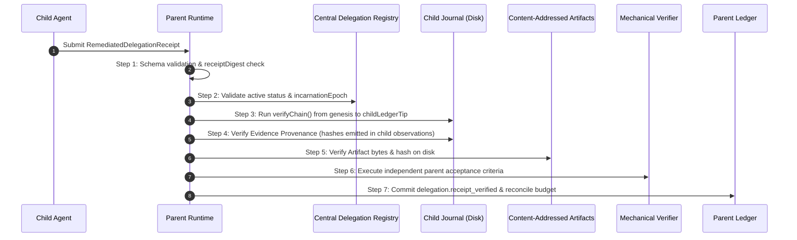

# FORGE STEP 8 — REMEDIATED DELEGATION RECEIPT PROTOCOL

**Document:** Protocol Specification — Remediated Cryptographic Receipt & Provenance Verification  
**Status:** REMEDIATED ARCHITECTURAL SPECIFICATION  
**Version:** FORGE v1.3-remediated-receipt  
**Date:** 2026-10-07  
**Remediates:** Finding S8-03 (Critical), Finding S8-11 (Medium)  
**Authors:** Principal Security Architect & Adversarial Engineering  

---

## 1. THE NON-NEGOTIABLE RECEIPT PRINCIPLES

1. $$\mathbf{RECEIPT \ne AUTHORITY}$$
   A receipt is an immutable, historical record proving past execution and outcome. Receipt verification **never** creates authority, widens grants, extends lifetimes, or delegates new capabilities. It exclusively transitions a parent DAG task to `succeeded` and reconciles escrowed budgets.
2. **Provenance Requirement (Remediates S8-03):** An agent cannot merely cite a hash of an artifact that exists on disk. An artifact is accepted as valid evidence **only if proven to have been generated by an authorized capability observation within that specific agent's verified ledger history**.
3. **Full-Chain Proof (Remediates S8-11):** The parent never trusts a single trailing hash. Acceptance requires verifying the entire hash chain from genesis to tip.

---

## 2. THE COMPREHENSIVE DELEGATION RECEIPT SCHEMA

```typescript
export const RemediatedDelegationReceiptSchema = z.object({
  // 1. Lineage & Identity Binding
  receiptId: z.string().regex(/^rcp_[0-9A-HJKMNP-TV-Z]{26}$/, "ULID format"),
  parentMissionId: MissionIdSchema,
  childMissionId: MissionIdSchema,
  delegationId: z.string().regex(/^del_[0-9A-HJKMNP-TV-Z]{26}$/),
  parentAgentId: z.string().min(1).max(64),
  childAgentId: z.string().min(1).max(64),
  incarnationEpoch: z.number().int().min(1), // Must match active epoch in registry

  // 2. Mission Plan & Task Binding
  planId: z.string().min(1).max(64),
  parentTaskId: z.string().min(1).max(64),
  grantId: GrantIdSchema,
  grantRevision: z.number().int().min(1),

  // 3. Execution Identity & Isolation Profile
  isolationProfile: z.enum(["sandboxed", "sandboxed-network", "host"]),
  capabilityIdentityQuad: z.object({
    capabilityId: z.string().max(64),
    version: z.string().regex(/^\d+\.\d+\.\d+$/),
    manifestHash: Sha256HexSchema,
    implementationHash: Sha256HexSchema,
  }).optional(),

  // 4. Cryptographic Ledger Anchor
  childLedgerGenesisHash: Sha256HexSchema, // Genesis record hash of child journal
  childLedgerTip: Sha256HexSchema,        // Tip hash of child journal.jsonl
  childRecordCount: z.number().int().min(1),

  // 5. Content-Addressed Evidence References
  evidenceRefs: z.array(Sha256HexSchema).min(1).max(64),

  // 6. Audited Budget Spend
  budgetConsumed: z.object({
    plannerTurns: z.number().int().min(0),
    modelCalls: z.number().int().min(0),
    tokensIn: z.number().int().min(0),
    tokensOut: z.number().int().min(0),
    capabilityCalls: z.number().int().min(0),
    retries: z.number().int().min(0),
    executionTimeMs: z.number().int().min(0),
    artifactBytes: z.number().int().min(0),
  }).strict(),

  // 7. Outcome & Replay Defense
  status: z.enum(["succeeded", "failed", "inconclusive"]),
  nonce: z.string().regex(/^non_[0-9A-HJKMNP-TV-Z]{26}$/),
  completedAt: Iso8601Schema,
  receiptDigest: Sha256HexSchema, // SHA-256 of canonical JSON of fields 1..7
}).strict();

export type RemediatedDelegationReceipt = z.infer<typeof RemediatedDelegationReceiptSchema>;
```

---

## 3. SEVEN-STEP MECHANICAL RECEIPT VERIFICATION PROCEDURE



### 3.1 Step Details & Remediation Enforcements:

1. **Schema & Digest Validation:**
   - Validates all fields against `RemediatedDelegationReceiptSchema`.
   - Computes canonical SHA-256 digest of fields and asserts equality with `receiptDigest`.
   - Checks `receipt.nonce` and `receipt.receiptDigest` against parent ledger's processed receipt set. Replay throws `DuplicateReceiptError`.
2. **Registry Status & Epoch Check (Remediates S8-05):**
   - Queries Central Delegation Registry for `receipt.delegationId`.
   - Asserts `entry.status !== "revoked"`. If revoked, throws `RevokedGrantReceiptError`.
   - Asserts `entry.childIncarnationEpoch === receipt.incarnationEpoch`. Stale epochs throw `StaleIncarnationError`.
   - Asserts `entry.parentMissionId === receipt.parentMissionId` and `entry.childMissionId === receipt.childMissionId` (blocks cross-mission theft).
3. **Full Child Chain Verification (Remediates S8-11):**
   - Opens `dataDir/missions/<childMissionId>/journal.jsonl`.
   - Invokes `verifyChain()` from record 1 to the end.
   - Asserts chain verification returns `{ ok: true }`.
   - Asserts final record's hash strictly equals `receipt.childLedgerTip`.
   - Asserts total record count equals `receipt.childRecordCount`.
4. **Evidence Provenance Verification (Remediates S8-03):**
   - Scans all verified records in the child journal.
   - For every hash $h \in \text{receipt}.\text{evidenceRefs}$:
     - Asserts $\exists$ record $r \in \text{ChildRecords}$ where $r.\text{kind}$ starts with `"observation."` AND ($r.\text{body}.\text{outputRef} == h \lor r.\text{body}.\text{bodyRef} == h \lor r.\text{body}.\text{afterHash} == h$).
     - If any evidence hash cannot be proven to have originated from a capability observation authored within that child's journal, the receipt is **immediately rejected as forged evidence citation theft** (`EvidenceProvenanceError`).
5. **Artifact Storage Integrity:**
   - For every hash $h \in \text{receipt}.\text{evidenceRefs}$, reads file at `artifacts/<h>`.
   - Computes physical SHA-256; asserts exact match.
6. **Parent Mechanical Verifier Execution:**
   - Executes parent verification tests declared in parent plan (e.g. running assertions in parent sandbox).
7. **Ledger Commitment & Reconciliation:**
   - Appends `delegation.receipt_verified` to parent journal with `fsyncSync()`.
   - Reconciles escrowed budget; updates parent task status to `succeeded`.

---

*Authored by Principal Security Architect & Adversarial Engineering.*
