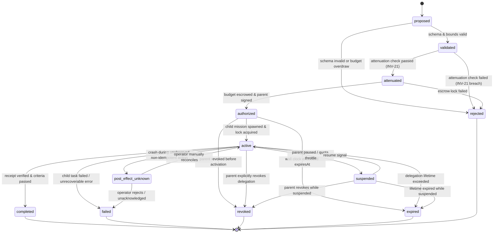

# FORGE STEP 8 — DELEGATION STATE MACHINE & TOPOLOGY MODEL

**Status:** FORMAL LIFECYCLE SPECIFICATION  
**Version:** FORGE v1.3-state-machine  
**Authors:** Principal Systems Architect & Security Engineering  
**Prerequisites:** Step 6 (Governance), Step 7A (Sandbox Isolation), Step 7B (Persistence)  

---

## 1. THE DELEGATION LIFECYCLE STATE MACHINE

A delegation in FORGE represents a durable, attenuated transfer of execution authority from a parent agent to a child sub-mission. A delegation **never becomes active merely because an agent instantiated an in-memory object**.



---

## 2. FORMAL STATE DEFINITIONS

1. **`proposed`**: Initial proposal generated by parent agent model/planner. Contains requested capabilities, constraints, budget, and objective. Pure in-flight proposal; zero execution authority.
2. **`validated`**: Syntactic and structural validation confirmed. Zod schemas pass, parameter types valid, parent mission in non-terminal executing state.
3. **`attenuated`**: Mathematical attenuation verified. The Authority Gate proves $A_{\text{child}} \subseteq A_{\text{parent}}$ across all 12 dimensions.
4. **`authorized`**: Child budget escrowed from parent unallocated pool. Immutable `delegation.authorized` record appended to parent journal with `fsyncSync()`.
5. **`active`**: Child mission container spawned, child sub-ledger initialized, child single-host mutex `.lock` acquired. Child agent reasoning and execution loop operational.
6. **`suspended`**: Child execution temporarily halted (e.g., parent paused, budget rate limit reached). Containers paused via SIGSTOP/cgroups. Authority frozen.
7. **`completed`**: Child finished work, generated cryptographic receipt, parent mechanical verifier verified all criteria, budget reconciled. **Terminal sink.**
8. **`failed`**: Child encountered permanent error, exceeded retries, or mechanical verification failed. Escrowed unused budget returned to parent. **Terminal sink.**
9. **`revoked`**: Parent grant revoked, operator cancelled delegation, or cascade revocation triggered. Child processes terminated immediately. **Terminal sink.**
10. **`expired`**: Wall clock passed `delegation.expiresAt`. Gate blocks all subsequent capability dispatches. **Terminal sink.**
11. **`post_effect_unknown`**: Child crashed while non-idempotent capability was in-flight without observation. Automatic recovery halted; operator reconciliation required.
12. **`rejected`**: Attenuation check, budget check, or depth limit failed during proposal phase. Never authorized. **Terminal sink.**

---

## 3. DETERMINISTIC STATE TRANSITION TABLE

Arbitrary transitions are mechanically blocked. Any attempt to invoke an unregistered transition throws `DelegationStateTransitionError`.

| Current State | Valid Next States | Trigger / Condition |
| :--- | :--- | :--- |
| **`proposed`** | `validated`, `rejected` | Schema check passes $\to$ `validated`; invalid $\to$ `rejected`. |
| **`validated`** | `attenuated`, `rejected` | Attenuation holds $\to$ `attenuated`; fails $\to$ `rejected`. |
| **`attenuated`** | `authorized`, `rejected` | Escrow locks funds $\to$ `authorized`; overdrawn $\to$ `rejected`. |
| **`authorized`** | `active`, `revoked`, `expired` | Process spawns $\to$ `active`; revocation $\to$ `revoked`; clock $\to$ `expired`. |
| **`active`** | `suspended`, `completed`, `failed`, `post_effect_unknown`, `revoked`, `expired` | Normal execution paths, receipts, failures, or interruptions. |
| **`suspended`** | `active`, `revoked`, `expired` | Resume signal $\to$ `active`; cancellation $\to$ `revoked`; clock $\to$ `expired`. |
| **`post_effect_unknown`** | `failed`, `active` | Operator ack $\to$ `active`; operator abort / timeout $\to$ `failed`. |
| **`completed`** | *(none — terminal)* | Immutable. Outgoing array `[]`. |
| **`failed`** | *(none — terminal)* | Immutable. Outgoing array `[]`. |
| **`revoked`** | *(none — terminal)* | Immutable. Outgoing array `[]`. |
| **`expired`** | *(none — terminal)* | Immutable. Outgoing array `[]`. |
| **`rejected`** | *(none — terminal)* | Immutable. Outgoing array `[]`. |

---

## 4. TOPOLOGY CONSTRAINTS & CYCLE PREVENTION

### 4.1 Strict Tree Topology Definition
The multi-agent execution hierarchy is strictly a directed rooted tree $T = (V, E)$ where:
- Root node $r \in V$ is the primary mission agent.
- Every child agent $c \in V \setminus \{r\}$ has indegree exactly 1 ($\text{in}(c) = 1$).
- Directed edges $(p, c) \in E$ represent direct delegation authorization from parent $p$ to child $c$.
- **DAG Delegation Forbidden:** Shared child agents (where two independent parents delegate to the same child agent) are strictly prohibited. Shared children would create authority laundering, budget cross-talk, and split-brain receipt verification.

### 4.2 Structural Limits
1. **Maximum Delegation Depth ($D_{\max}$):**
   $$\text{depth}(v) \le D_{\max} \quad (\text{Default: } 2, \text{ Hard Maximum: } 3)$$
   Root is at depth 0. A child spawned by root is at depth 1. A child spawned by depth 1 is at depth 2. Any proposal from depth 2 is rejected by the Gate.
2. **Maximum Fanout ($F_{\max}$):**
   $$\text{activeChildren}(p) \le F_{\max} \quad (\text{Default: } 3)$$
   No agent may hold more than 3 concurrently active child delegations.
3. **Maximum Total Descendants ($N_{\max}$):**
   $$\sum_{v \in V \setminus \{r\}} 1 \le N_{\max} \quad (\text{Default: } 10)$$
   Global cap prevents runaway tree explosion or token exhaustion attacks.

### 4.3 Cycle Prevention Algorithm
When an agent $P$ submits a `DelegationProposal` targeting child agent specification $C$:
```text
function validateTopology(P, C):
    1. Let ancestors = getAncestors(P) // includes P and all predecessors up to root
    2. If C.agentId in ancestors or C.missionId in ancestors:
           throw CycleDetectedError("Delegation cycle detected: target exists in ancestor lineage")
    3. If P.depth + 1 > D_max:
           throw MaxDepthExceededError("Delegation depth limit exceeded")
    4. If count(P.activeChildren) + 1 > F_max:
           throw MaxFanoutExceededError("Parent active fanout limit exceeded")
    5. If count(globalActiveDescendants) + 1 > N_max:
           throw MaxDescendantsExceededError("Global mission tree descendant limit exceeded")
    6. Return VALID
```

---

*Authored by Principal Systems Architect & Security Engineering.*
